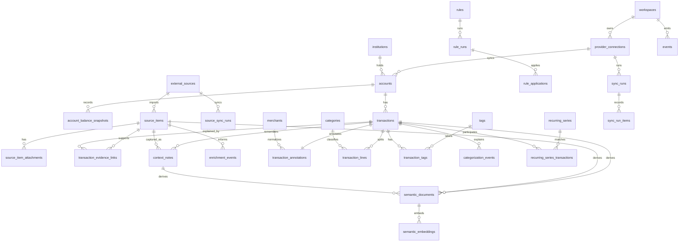

# Finance API Database Design

Created: 2026-05-24

> **Historical note (2026-07-16):** Teller was the original prototype provider and its
> API was withdrawn; it has been removed from the app. Plaid is now the primary bank
> provider (with SnapTrade and SimpleFIN), and the internal ledger abstraction is
> provider-neutral (`Ledger`, `replaceLedgerInDb`, `ledger-normalization.ts`). The
> Teller-specific sync rules below are retained only as design context.

This note proposes the canonical database and API shape for AI Finances. It uses Copilot Money as a local storage reference, the current Teller-backed prototype as implementation context, PGlite as the local Postgres-compatible runtime, and Kanoon/Stripe-style API design as the taste bar.

## Design Goal

Build a private finance API that behaves like a small Stripe for personal money data:

- resource nouns are stable and unsurprising;
- every object has an `id` and `object`;
- list endpoints use a consistent envelope and cursor parameters;
- provider facts are separated from user annotations;
- source evidence from email, Amazon, Instacart, Airbnb, and notes is linked to transactions rather than flattened into them;
- mutating requests are idempotent and auditable;
- raw bank payloads are retained for reconciliation but not exposed casually;
- the local database embeds every transaction by default and can run pgvector for semantic search and RAG;
- AI suggestions are events and candidates, not silent mutations.

## Copilot Money Storage Observations

The local Copilot Money app uses a split store:

- SQLite stores the operational ledger tables:
  - `Transactions`: 5,815 rows observed locally.
  - `accountDailyBalance`: 4,070 rows observed locally.
  - `grdb_migrations`: migration bookkeeping.
- SQLite indexes are practical, not elaborate:
  - transactions by date and user id;
  - balance history by account id and date.
- The `Transactions` table is wider than a minimal ledger. It includes provider ids, account and item ids, original and cleaned names, amount variants, pending linkage, recurring linkage, category ids, user review state, user notes, Amazon enrichment, intelligence category fields, tag ids, financial goal id, and internal transfer matching fields.
- The balance table keeps account-level snapshots with current, available, limit, source, and range fields.
- Firestore's local LevelDB cache appears to carry richer app objects and metadata outside SQLite. Collection names observed without dumping user values include `items`, `investment_prices`, `investment_performance`, `investment_splits`, `securities`, `user_items`, `budgets`, `categories`, `tags`, `financial_goals`, `subscriptions`, and Amazon-related data.

The lesson is strong: Copilot keeps a local transaction/balance ledger, but important app concepts live outside the obvious SQLite tables. For our API, that split should become explicit relational design instead of opaque app cache behavior.

## API Taste Principles

Kanoon's documentation style is a good target: object sections first, then list/retrieve endpoints, query parameters, and terse examples. Stripe's API principles add the operational layer: stable resource IDs, consistent errors, idempotency, request IDs, metadata, response expansion, cursor pagination, and explicit versioning.

Concrete choices for AI Finances:

- Use `/v1` from the first public API route.
- Use bearer API keys for app/server clients.
- Return `Request-Id` on every response.
- Accept `Idempotency-Key` on every mutating request.
- Use `object` strings on all resources, for example `transaction`, `account`, `category`, `sync_run`.
- Use list envelopes:

```json
{
  "object": "list",
  "data": [],
  "first_id": null,
  "last_id": null,
  "has_more": false
}
```

- Use `limit`, `after`, `before`, and `order` for list pagination.
- Use `expand[]` for related resources, for example `expand[]=account` or `expand[]=category`.
- Use a Stripe-like error shape:

```json
{
  "error": {
    "type": "invalid_request_error",
    "code": "unknown_category",
    "message": "No category exists with that id.",
    "param": "category",
    "request_id": "req_..."
  }
}
```

## Local Database Decision

Use PGlite as the default local database for the web prototype and local API runtime.

PGlite is a WASM Postgres build packaged for TypeScript/JavaScript. It can run in Node, Bun, Deno, or the browser, persist to the local filesystem in Node/Bun, and persist to IndexedDB or OPFS in browser environments. Its extension catalog includes `pgvector`, and the main package exposes the vector extension through `@electric-sql/pglite/vector`.

The database boundary should be:

- **Local default:** PGlite persisted under an ignored local data directory, for example `data/local/pglite/`.
- **Vector default:** enable `pgvector` through PGlite and run `CREATE EXTENSION IF NOT EXISTS vector`.
- **Hosted-compatible:** keep migrations to standard Postgres plus pgvector so the same schema can move to a normal Postgres server later.
- **Repository boundary:** app code talks to repositories and API serializers, not directly to PGlite-specific APIs outside `apps/web/lib/db`.
- **Browser-local future:** if the app later needs offline browser mode, use IndexedDB/OPFS persistence and a worker/multi-tab strategy rather than each tab owning a separate database.

PGlite is the right local choice because it gives us a real Postgres query model, local persistence, and vector search without requiring a separate database server. It is not the hosted multi-user runtime; hosted deployment should use regular Postgres with pgvector and the same migrations.

## Data Model Decisions

### D1. Provider facts and user overlays are separate

Provider facts come from Teller or another sync source. User overlays are categories, split lines, tags, review state, notes, hidden state, rules, and AI decisions. Resync may update provider facts, but it must not erase overlays.

### D2. Money uses signed minor units

API and DB amounts should use signed integer minor units:

- `amount = -4287`, `currency = "usd"` means an outflow of USD 42.87.
- `amount = 500000`, `currency = "usd"` means an inflow of USD 5,000.00.

This avoids floating point drift, keeps aggregation simple, and matches the current app direction where spending is negative and income is positive. Provider decimal strings remain in raw payloads for audit.

### D3. Transactions can have lines, but v1 is not full double-entry

Provider transactions are imported account movements, not accounting journal entries. The v1 model should support `transaction_lines` for category splits and budget allocation, while deferring a full double-entry journal until there is a real need for synthetic assets, liabilities, or manual accounting.

### D4. Raw payloads are retained behind a boundary

Keep normalized columns for query speed and product behavior, and store raw provider payloads in a controlled `raw_provider_payloads` table for reconciliation and debugging. The public API should expose raw payloads only through an admin/debug route, not by default.

### D5. AI writes suggestions, not truth

AI categorization, merchant cleanup, recurring detection, and anomaly detection should write suggestion/event rows. A user, rule, or trusted automatic policy can accept them into annotations.

### D6. Local-first storage uses PGlite, not SQLite

Copilot's SQLite design is useful evidence, but the API should use a Postgres-compatible local database so the local app, API docs, tests, and future hosted service share one schema. PGlite is the local runtime; standard Postgres is the hosted/runtime scale-out target.

### D7. Embeddings are index records, not source records

Vector embeddings should be derived from canonical records and stored in a separate semantic index. Every canonical transaction gets a semantic document and embedding by default; higher-level merchant, category, recurring, budget, and monthly-summary documents can be added as derived retrieval units. The embedding text should be deterministic, redacted when needed, and versioned by model. Re-embedding should never mutate the underlying transaction, category, tag, merchant, recurring, budget, source item, or context note record.

### D8. Evidence is linked, not merged

Email messages, Amazon orders, Outlook messages, Instacart grocery items/orders, Airbnb listing or trip context, receipt attachments, typed notes, and voice-note transcripts are evidence records. A transaction can link to many evidence records, and an evidence record can support many transactions. LLM enrichment may propose links, categories, tags, merchant normalization, or context summaries, but those proposals remain reviewable.

### D9. Rules are action graphs

Rules should support exact and partial matching like Copilot Money, but the model should not stop there. A rule has conditions, actions, provenance, preview results, and run history. Actions can classify, tag, mark reviewed, create context, link evidence, or trigger a bounded source search such as "search Gmail for this merchant around the transaction date."

### D10. Source connectors are replaceable adapters

Gmail, Outlook, Amazon, Instacart, Airbnb, and future sources should all write normalized `source_items` and `transaction_evidence_links`. `gogcli` is a good Gmail adapter candidate because it supports JSON output, sanitized message reads, multiple Google accounts, and Gmail watch/Pub/Sub hooks. The Outlook Printing Press CLI is a good Outlook adapter candidate because it supports delta sync, agent JSON mode, and local/offline search. Amazon should start with receipts and user-provided exports or order CLI output rather than assuming a stable official consumer order API. Instacart should use the Printing Press purchase-history/backfill store as grocery line-item evidence. Airbnb should be read-only travel/lodging context from listing, wishlist, watch, and price data; it can explain travel charges, but should not be treated as a primary receipt ledger unless an actual booking record is available.

## Proposed Core Tables

### Identity and API

| Table | Purpose | Key columns |
| --- | --- | --- |
| `workspaces` | Owner boundary for personal or future shared finance data. | `id`, `name`, `created_at` |
| `users` | Human users. Single-user first, but no schema dead end. | `id`, `email`, `display_name`, `created_at` |
| `workspace_memberships` | User access to a workspace. | `workspace_id`, `user_id`, `role` |
| `api_keys` | Server/client API credentials. Store only hashes. | `id`, `workspace_id`, `name`, `key_hash`, `scopes`, `last_used_at`, `revoked_at` |
| `idempotency_keys` | Idempotent mutation registry. | `workspace_id`, `key`, `method`, `path`, `request_hash`, `response_status`, `response_body`, `expires_at` |
| `api_request_logs` | Request tracing without payload sprawl. | `id`, `workspace_id`, `request_id`, `method`, `path`, `status`, `duration_ms`, `created_at` |

### Provider Sync

| Table | Purpose | Key columns |
| --- | --- | --- |
| `institutions` | Financial institutions normalized across accounts. | `id`, `provider`, `provider_institution_id`, `name`, `metadata` |
| `provider_connections` | Teller enrollments and future providers. | `id`, `workspace_id`, `provider`, `environment`, `display_name`, `status`, `institution_id`, `secret_ref`, `last_synced_at`, `disconnected_reason` |
| `raw_provider_payloads` | Controlled raw JSON archive. | `id`, `workspace_id`, `provider`, `resource_type`, `provider_resource_id`, `payload_hash`, `payload`, `received_at` |
| `sync_runs` | One sync attempt across a connection or all connections. | `id`, `workspace_id`, `connection_id`, `status`, `started_at`, `finished_at`, `accounts_seen`, `transactions_seen`, `error_code`, `error_message` |
| `sync_run_items` | Per-resource sync results. | `id`, `sync_run_id`, `resource_type`, `resource_id`, `provider_resource_id`, `action`, `status`, `message` |
| `provider_events` | Incoming Teller webhooks and internal sync events. | `id`, `workspace_id`, `provider`, `provider_event_id`, `type`, `payload`, `received_at`, `processed_at`, `status` |

### External Sources and Evidence

| Table | Purpose | Key columns |
| --- | --- | --- |
| `external_sources` | Configured non-bank evidence sources. | `id`, `workspace_id`, `kind`, `display_name`, `account_identifier_hash`, `adapter`, `status`, `secret_ref`, `poll_interval`, `last_synced_at`, `metadata` |
| `source_sync_runs` | Periodic, on-demand, or webhook-triggered source syncs. | `id`, `workspace_id`, `source_id`, `trigger`, `status`, `started_at`, `finished_at`, `items_seen`, `items_created`, `items_updated`, `cursor_before`, `cursor_after`, `error_code`, `error_message` |
| `source_items` | Normalized external evidence records. | `id`, `workspace_id`, `source_id`, `external_id`, `kind`, `occurred_at`, `sender`, `subject`, `title`, `body_hash`, `body_text`, `amount`, `currency`, `order_id`, `merchant_hint`, `raw_payload_id`, `metadata`, `created_at` |
| `source_item_attachments` | Receipt PDFs, images, email attachments, exports, and audio files. | `id`, `workspace_id`, `source_item_id`, `kind`, `filename`, `content_type`, `size_bytes`, `storage_ref`, `text_hash`, `extracted_text`, `metadata` |
| `transaction_evidence_links` | Links evidence to transactions with confidence and review state. | `id`, `workspace_id`, `transaction_id`, `source_item_id`, `relationship`, `confidence`, `status`, `matched_by`, `match_reasons`, `reviewed_at`, `created_at` |
| `context_notes` | User-supplied typed or voice context. | `id`, `workspace_id`, `transaction_id`, `source_item_id`, `kind`, `body_text`, `transcript_text`, `occurred_at`, `created_by`, `metadata`, `created_at` |
| `enrichment_jobs` | LLM or deterministic enrichment tasks. | `id`, `workspace_id`, `target_type`, `target_id`, `job_type`, `status`, `model`, `input_hash`, `started_at`, `finished_at`, `error_message` |
| `enrichment_events` | Extracted facts, proposed labels, and explanations. | `id`, `workspace_id`, `job_id`, `target_type`, `target_id`, `source_item_id`, `event_type`, `payload`, `confidence`, `status`, `created_at`, `resolved_at` |

### Accounts and Balances

| Table | Purpose | Key columns |
| --- | --- | --- |
| `accounts` | User-facing account objects. | `id`, `workspace_id`, `connection_id`, `institution_id`, `provider_account_id`, `name`, `mask`, `type`, `subtype`, `status`, `currency`, `included_in_net_worth`, `last_synced_at` |
| `account_balance_snapshots` | Time series for balances and net worth. | `id`, `workspace_id`, `account_id`, `as_of_date`, `captured_at`, `ledger_balance`, `available_balance`, `limit_amount`, `currency`, `source`, `raw_payload_id` |
| `account_settings` | User-owned account display and behavior. | `account_id`, `display_name`, `group_name`, `sort_order`, `included_in_net_worth`, `hidden_at` |

### Transactions and Annotations

| Table | Purpose | Key columns |
| --- | --- | --- |
| `transactions` | Canonical normalized provider transaction facts. | `id`, `workspace_id`, `account_id`, `connection_id`, `provider_transaction_id`, `status`, `date`, `authorized_at`, `posted_at`, `amount`, `currency`, `description`, `counterparty_name`, `counterparty_type`, `provider_category`, `provider_type`, `running_balance`, `raw_payload_id`, `last_synced_at` |
| `transaction_annotations` | User-owned overlay for a transaction. | `transaction_id`, `reviewed_at`, `note`, `hidden_at`, `merchant_id`, `metadata`, `updated_at` |
| `transaction_lines` | Category split and budget allocation lines. | `id`, `transaction_id`, `category_id`, `amount`, `currency`, `memo`, `source`, `sort_order` |
| `transaction_links` | Relationships such as pending-to-posted and transfers. | `id`, `workspace_id`, `source_transaction_id`, `target_transaction_id`, `type`, `confidence`, `created_by` |
| `tags` | Workspace tag dictionary. | `id`, `workspace_id`, `name`, `color`, `created_at`, `archived_at` |
| `transaction_tags` | Many-to-many tags. | `transaction_id`, `tag_id`, `created_by`, `created_at` |
| `merchants` | Normalized merchant/counterparty records. | `id`, `workspace_id`, `display_name`, `canonical_name`, `category_id`, `metadata` |

### Categorization, Rules, Recurrings, Budgets

| Table | Purpose | Key columns |
| --- | --- | --- |
| `categories` | Hierarchical category dictionary. | `id`, `workspace_id`, `name`, `slug`, `parent_id`, `kind`, `icon`, `color`, `sort_order`, `archived_at` |
| `rules` | Previewable deterministic and LLM-assisted rules. | `id`, `workspace_id`, `name`, `priority`, `scope`, `conditions`, `actions`, `enabled`, `created_by`, `last_applied_at` |
| `rule_runs` | Preview or execute runs for one or more rules. | `id`, `workspace_id`, `rule_id`, `mode`, `status`, `matched_count`, `changed_count`, `started_at`, `finished_at` |
| `rule_applications` | Per-transaction rule effects and audit trail. | `id`, `workspace_id`, `rule_id`, `rule_run_id`, `transaction_id`, `action_type`, `before`, `after`, `status`, `created_at` |
| `categorization_events` | Audit trail of provider/rule/manual/AI category decisions. | `id`, `workspace_id`, `transaction_id`, `source`, `category_id`, `confidence`, `model`, `rule_id`, `status`, `evidence`, `created_at`, `resolved_at` |
| `recurring_series` | Detected and user-confirmed recurring streams. | `id`, `workspace_id`, `name`, `merchant_id`, `category_id`, `cadence`, `expected_amount`, `currency`, `next_expected_date`, `status`, `detection_source` |
| `recurring_series_transactions` | Links transactions to recurring streams. | `series_id`, `transaction_id`, `match_confidence`, `created_at` |
| `budgets` | Budget containers. | `id`, `workspace_id`, `name`, `period`, `currency`, `status` |
| `budget_allocations` | Budget amounts by category and period. | `id`, `budget_id`, `category_id`, `period_start`, `period_end`, `amount`, `rollover_policy` |

### Semantic Index

| Table | Purpose | Key columns |
| --- | --- | --- |
| `embedding_models` | Embedding model/version registry. | `id`, `provider`, `model`, `dimensions`, `distance_metric`, `created_at`, `retired_at` |
| `semantic_documents` | Deterministic text documents derived from finance resources. | `id`, `workspace_id`, `resource_type`, `resource_id`, `title`, `body_hash`, `body`, `metadata`, `stale_at`, `created_at`, `updated_at` |
| `semantic_embeddings` | pgvector-backed embeddings for semantic documents. | `id`, `workspace_id`, `document_id`, `model_id`, `embedding`, `body_hash`, `source`, `created_at` |
| `semantic_search_events` | Local search/eval audit without logging secrets. | `id`, `workspace_id`, `query_hash`, `model_id`, `result_resource_ids`, `created_at` |

### Events and Webhooks

| Table | Purpose | Key columns |
| --- | --- | --- |
| `events` | Internal API events clients can list. | `id`, `workspace_id`, `type`, `resource_type`, `resource_id`, `data`, `created_at` |
| `webhook_endpoints` | Outbound webhook subscriptions. | `id`, `workspace_id`, `url`, `enabled_events`, `secret_ref`, `status` |
| `webhook_deliveries` | Outbound delivery attempts. | `id`, `event_id`, `endpoint_id`, `status`, `attempt_count`, `next_attempt_at`, `last_error` |
| `audit_log` | Security and user-visible data changes. | `id`, `workspace_id`, `actor_type`, `actor_id`, `action`, `resource_type`, `resource_id`, `diff`, `created_at` |

## Relationship Sketch



## Public API Resources

### Accounts

- `GET /v1/accounts`
- `GET /v1/accounts/{account_id}`
- `GET /v1/accounts/{account_id}/balances`
- `PATCH /v1/accounts/{account_id}` for user-owned settings only.

### Transactions

- `GET /v1/transactions`
- `GET /v1/transactions/{transaction_id}`
- `PATCH /v1/transactions/{transaction_id}` for annotations only: `category`, `lines`, `tags`, `note`, `reviewed`, `hidden`, `merchant`.
- `GET /v1/transactions/{transaction_id}/categorization_events`

Supported list filters:

- `account`
- `category`
- `tag`
- `status`
- `reviewed`
- `date_gte`
- `date_lte`
- `amount_gte`
- `amount_lte`
- `q`

### Categories and Tags

- `GET /v1/categories`
- `POST /v1/categories`
- `PATCH /v1/categories/{category_id}`
- `GET /v1/tags`
- `POST /v1/tags`
- `PATCH /v1/tags/{tag_id}`

### Sources, Evidence, and Context

- `GET /v1/sources`
- `POST /v1/sources`
- `POST /v1/sources/{source_id}/sync_runs`
- `GET /v1/source_items`
- `GET /v1/source_items/{source_item_id}`
- `POST /v1/transactions/{transaction_id}/context_notes`
- `GET /v1/transactions/{transaction_id}/evidence`
- `POST /v1/transactions/{transaction_id}/evidence_links`
- `POST /v1/enrichment_jobs`

Source adapters should support both periodic and on-demand sync triggers. Realtime is modeled as a webhook/push trigger where the adapter supports it, such as Gmail watch/Pub/Sub through `gogcli`.

Current local implementation exposes `GET /api/v1/sources`, `POST /api/v1/sources/{source_id}/sync-runs`, `GET /api/v1/source-items`, and `POST /api/v1/transactions/{transaction_id}/context-notes`. The source sync route executes the approved local CLI, inserts only actual returned records into `source_items`, and persists empty/error sync runs with actionable messages instead of fabricating evidence rows. Typed context notes are stored as user-owned `source_items`, linked to their transaction as accepted `user_context` evidence, and included in transaction semantic documents.

### Rules

- `GET /v1/rules`
- `POST /v1/rules`
- `GET /v1/rules/{rule_id}`
- `PATCH /v1/rules/{rule_id}`
- `POST /v1/rules/{rule_id}/preview`
- `POST /v1/rules/{rule_id}/run`
- `GET /v1/rule_runs/{rule_run_id}`

Rule actions should include `set_category`, `add_tag`, `remove_tag`, `mark_reviewed`, `link_evidence`, `create_context_note`, `trigger_source_search`, and `enqueue_enrichment_job`.

### Sync and Connections

- `GET /v1/connections`
- `GET /v1/connections/{connection_id}`
- `POST /v1/connections/{connection_id}/sync_runs`
- `GET /v1/sync_runs`
- `GET /v1/sync_runs/{sync_run_id}`
- `GET /v1/events`

### Recurrings and Budgets

- `GET /v1/recurring_series`
- `GET /v1/recurring_series/{series_id}`
- `PATCH /v1/recurring_series/{series_id}`
- `GET /v1/budgets`
- `POST /v1/budgets`
- `GET /v1/budgets/{budget_id}`
- `PATCH /v1/budgets/{budget_id}`

### Search

- `POST /v1/search`
- `GET /v1/search/events`

Search should support lexical, vector, and hybrid modes. The default user-facing mode should be hybrid: exact filters and keyword constraints first, then vector ranking over eligible local semantic documents.

## Example Objects

### Transaction

```json
{
  "id": "txn_2zGQ7yQ4Qp2x",
  "object": "transaction",
  "account": "acct_9mL2rH1pQe0a",
  "date": "2026-05-22",
  "authorized_at": null,
  "posted_at": "2026-05-22",
  "status": "posted",
  "amount": -4287,
  "currency": "usd",
  "description": "CARD PURCHASE",
  "counterparty": {
    "object": "counterparty",
    "name": "Example Coffee",
    "type": "organization"
  },
  "category": "cat_food",
  "lines": [
    {
      "id": "txnl_s8yJf9K2",
      "object": "transaction_line",
      "category": "cat_food",
      "amount": -4287,
      "currency": "usd"
    }
  ],
  "tags": ["tag_weekend"],
  "reviewed": true,
  "metadata": {}
}
```

### Sync Run

```json
{
  "id": "sync_vn4W9f3a",
  "object": "sync_run",
  "connection": "con_teller_main",
  "status": "succeeded",
  "started_at": "2026-05-24T14:00:00Z",
  "finished_at": "2026-05-24T14:00:12Z",
  "accounts_seen": 4,
  "transactions_seen": 128,
  "error": null
}
```

## Teller Sync Rules

Teller-specific behavior to encode in the sync layer:

- An enrollment maps to `provider_connections`.
- A Teller account maps to `accounts` with `provider_account_id`.
- Teller balances create `account_balance_snapshots`; do not store only the latest balance.
- Teller transaction amounts arrive as signed strings, but the sign is account-convention dependent. Normalize to the app convention where spending/outflow is negative and income/credits are positive: keep deposit account signs and invert credit-card transaction signs from Teller's liability convention. Preserve the raw string in `raw_provider_payloads`.
- Teller transaction ids are stable enough to upsert by provider id, but pending-to-posted transitions can change dates and sometimes create new ids. The sync should use a 7-10 day overlap window and `transaction_links` to preserve pending/posting relationships.
- Teller webhooks create `provider_events`, then enqueue or trigger `sync_runs`; webhook payloads are not a replacement for normalized transaction upsert.

## Semantic Index Rules

Vectorization should be local-first and explicit:

- Every transaction gets a semantic document and embedding by default.
- Transaction documents can include normalized merchant/counterparty, cleaned description, category, tags, linked evidence summaries, context notes, recurring series, and amount/date buckets.
- Source items and context notes can also become semantic documents when they are useful for retrieval or transaction augmentation.
- Do not embed raw provider payloads by default.
- User notes, voice transcripts, and email bodies are sensitive. Include them only when the embedding provider is local or when the user explicitly allows hosted embedding for that source.
- Every semantic document stores a `body_hash`; sync or annotation changes mark stale documents for re-embedding.
- `semantic_embeddings` points to `embedding_models` so a model upgrade can run side by side with the old index.
- Use cosine distance for natural-language search unless evals show a better metric.
- Keep vector index construction behind migrations that run in both PGlite and hosted Postgres with pgvector.
- The current local implementation uses deterministic token-hash embeddings as the privacy-preserving baseline. Hosted embedding providers can be added only behind explicit privacy controls and model/version records.

## Source Enrichment Rules

Each source adapter writes the same evidence shape:

- **Gmail:** Use `gogcli` for multiple accounts, sanitized reads, Gmail search/get, and optional watch/PubSub push. Start with periodic/on-demand search around transaction merchant, amount, and date; add push later for new receipts.
- **Outlook:** Use the Printing Press Outlook CLI for delta sync and agent JSON output. Start with `sync`, message list/get, and local/offline search commands; treat send/update commands as out of scope for finance enrichment.
- **Amazon:** Start with Amazon receipt emails and user-provided order exports or account data downloads. Add direct Amazon account access only behind a dedicated adapter with explicit approval and clear failure modes.
- **Instacart:** Use the Printing Press Instacart CLI's local purchase-history/backfill store for grocery order and item evidence. Treat cart mutation commands as out of scope for finance enrichment.
- **Airbnb:** Use the Printing Press Airbnb CLI's read-only listing, wishlist, watchlist, host, and price context to explain travel/lodging charges. Treat it as contextual evidence unless an actual booking artifact is available.
- **Manual context:** Typed notes write directly to `context_notes`. Voice notes write an attachment plus a transcript; local transcription is preferred before hosted transcription.
- **LLM enrichment:** LLMs read bounded transaction + evidence + context packets and write `enrichment_events`, proposed `transaction_evidence_links`, category/tag suggestions, merchant normalization candidates, and rule suggestions. They do not mutate canonical records directly.

## Migration From Current Prototype

The current app stores normalized Teller data in `data/local/teller-ledger.json`. The first API implementation should treat that file as a bootstrap source only:

1. Import saved enrollments from ignored `.env` into encrypted `provider_connections.secret_ref` records.
2. Import existing accounts and transactions into the new tables.
3. Preserve current transaction tags, notes, categories, and reviewed state as annotations/lines/tags.
4. Switch screens to read through the API-backed query layer.
5. Remove JSON ledger writes once persistence is verified.

## Indexing and Constraints

Recommended constraints:

- `provider_connections`: unique `(workspace_id, provider, environment, external_enrollment_id)` where available.
- `accounts`: unique `(workspace_id, provider, provider_account_id)`.
- `transactions`: unique `(workspace_id, provider, provider_transaction_id)`.
- `transaction_lines`: sum of line amounts must equal transaction amount for non-hidden transactions.
- `transaction_tags`: unique `(transaction_id, tag_id)`.
- `categories`: unique `(workspace_id, slug)` for active categories.
- `external_sources`: unique `(workspace_id, kind, account_identifier_hash)`.
- `source_items`: unique `(workspace_id, source_id, external_id)`.
- `transaction_evidence_links`: unique `(transaction_id, source_item_id, relationship)`.
- `idempotency_keys`: unique `(workspace_id, key)`.
- `provider_events`: unique `(workspace_id, provider, provider_event_id)` when the provider supplies an event id.

Recommended indexes:

- `transactions(workspace_id, date desc, id desc)`
- `transactions(workspace_id, account_id, date desc)`
- `transactions(workspace_id, status, date desc)`
- `transaction_lines(category_id, transaction_id)`
- `transaction_tags(tag_id, transaction_id)`
- `account_balance_snapshots(account_id, as_of_date desc)`
- `sync_runs(workspace_id, started_at desc)`
- `source_sync_runs(workspace_id, source_id, started_at desc)`
- `source_items(workspace_id, source_id, occurred_at desc)`
- `transaction_evidence_links(transaction_id, confidence desc)`
- `rules(workspace_id, enabled, priority)`
- `events(workspace_id, created_at desc, id desc)`
- `semantic_documents(workspace_id, resource_type, resource_id)`
- `semantic_embeddings` vector index using the active pgvector operator class for the selected distance metric.

## Deferred Choices

- Full double-entry ledger: defer until manual accounts, synthetic transfers, or investment lots require it.
- Investment holdings and tax lots: design after the first banking/credit-card API is stable.
- Multi-currency FX rates: reserve `currency` and integer amount fields now, add rate tables when real multi-currency data appears.
- Hosted multi-tenant deployment: keep workspace boundaries now, but optimize first for the user's local/private PGlite app.
- Embedding provider: choose local embeddings by default if quality is acceptable; use hosted embeddings only behind explicit privacy controls.
- Amazon account adapter: start with receipts and exports; direct account sync requires a separate review of reliability, security, and terms.
- Realtime ingestion: start with periodic and on-demand sync; add source-specific push where the connector supports it, such as Gmail watch.

## Sources

- PGlite overview: https://pglite.dev/docs/about
- PGlite filesystem persistence: https://pglite.dev/docs/filesystems
- PGlite extensions and pgvector: https://pglite.dev/extensions/
- PGlite API extensions example: https://pglite.dev/docs/api
- gogcli repository: https://github.com/openclaw/gogcli
- gogcli Gmail workflows: https://gogcli.sh/gmail-workflows.html
- gogcli Gmail watch: https://gogcli.sh/watch.html
- CLI Printing Press repository: https://github.com/mvanhorn/cli-printing-press
- Printing Press Outlook Email skill: https://github.com/mvanhorn/printing-press-library/blob/main/cli-skills/pp-outlook-email/SKILL.md
- Kanoon API docs: https://docs.kanoon.dev/
- Stripe API overview: https://docs.stripe.com/apis
- Stripe authentication: https://docs.stripe.com/api/authentication
- Stripe idempotent requests: https://docs.stripe.com/api/idempotent_requests
- Stripe pagination: https://docs.stripe.com/api/pagination
- Stripe metadata: https://docs.stripe.com/metadata
- Teller accounts: https://teller.io/docs/api/accounts
- Teller account balances: https://teller.io/docs/api/account/balances
- Teller transactions: https://teller.io/docs/api/account/transactions
- Teller webhooks: https://teller.io/docs/api/webhooks
